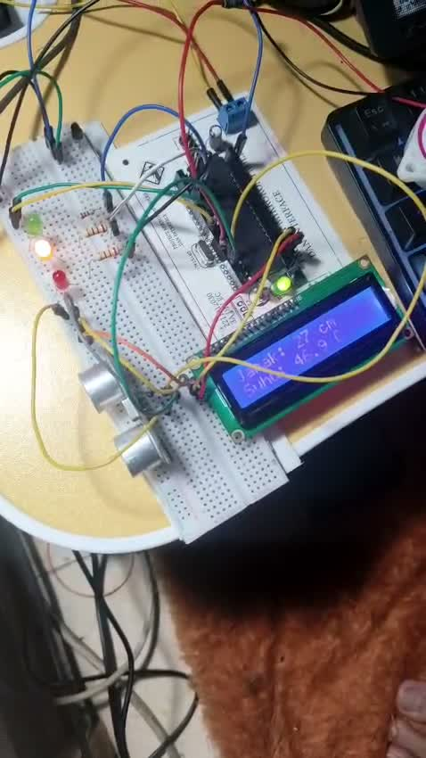
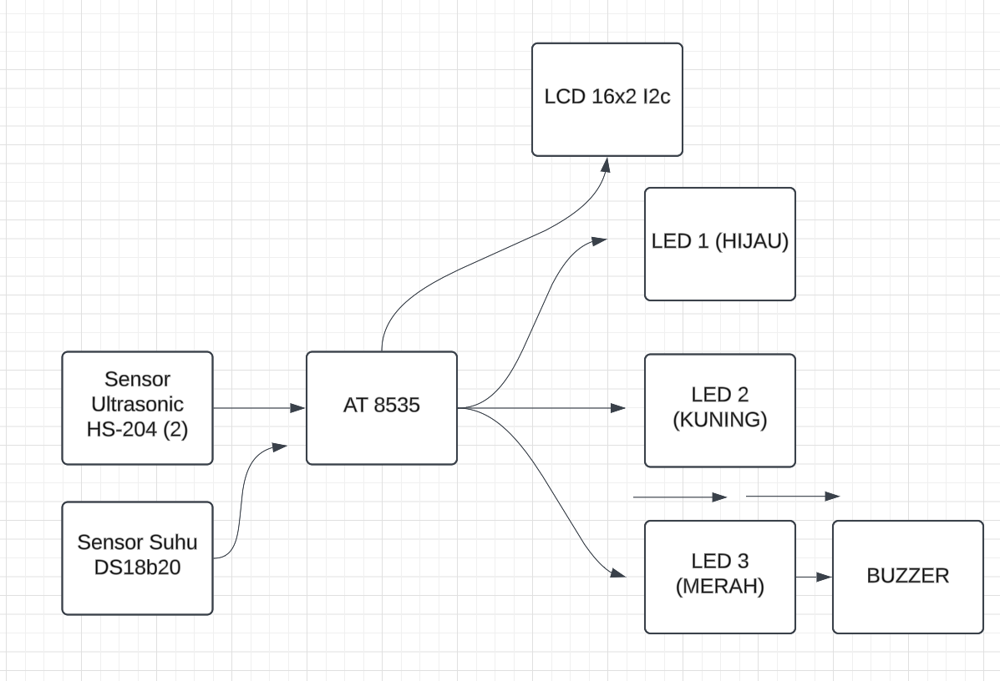
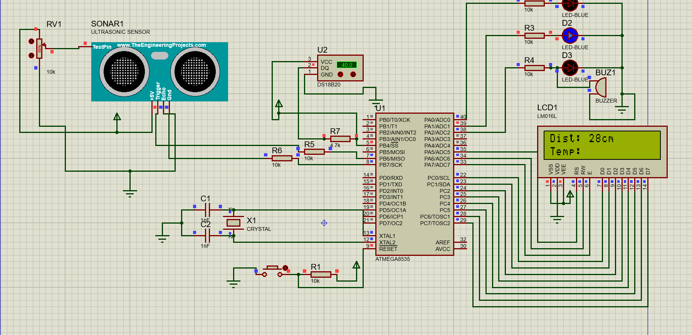
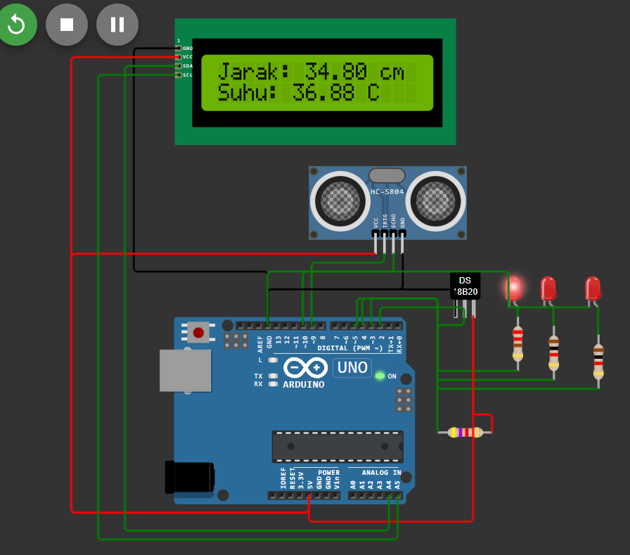
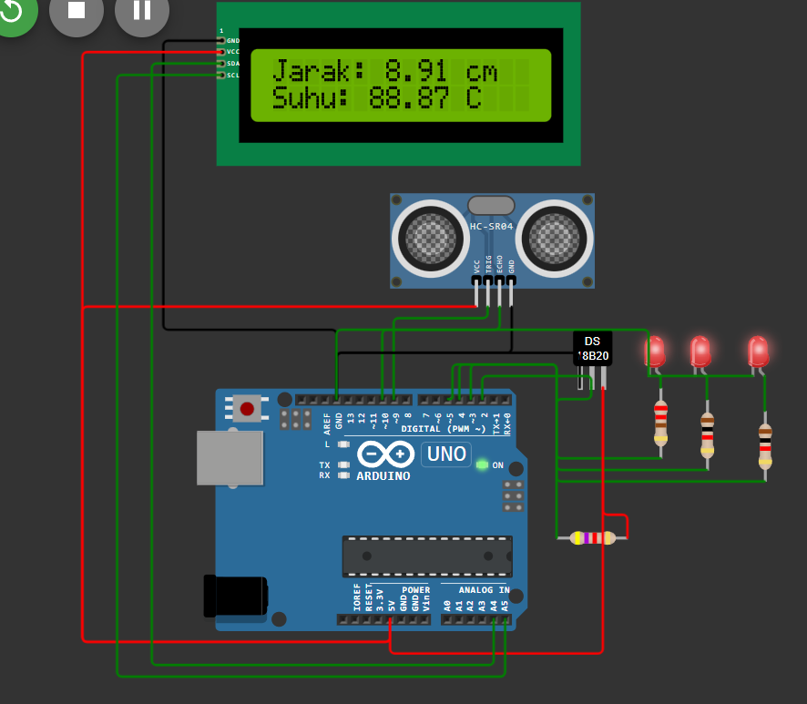
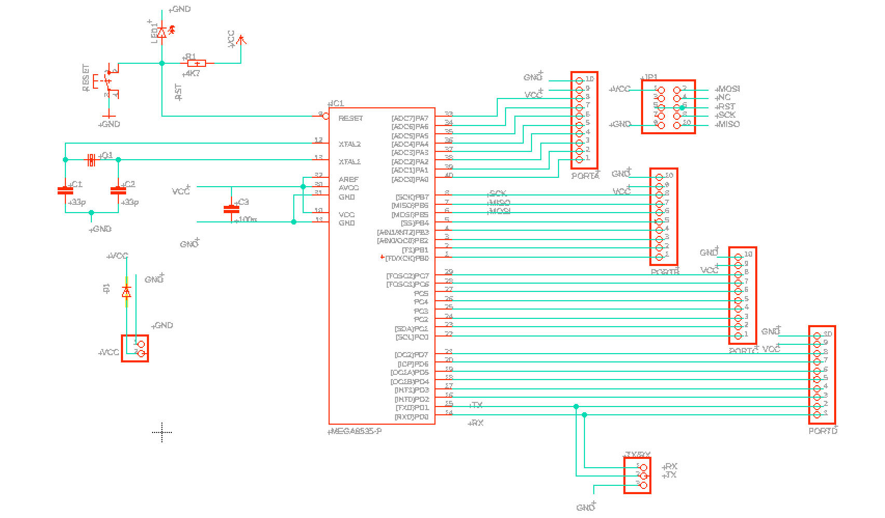
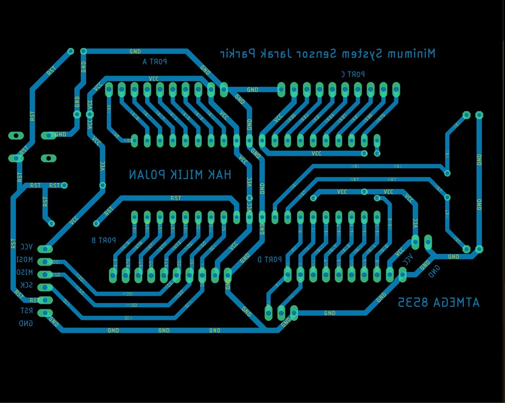

# Vehicle Safety on ATmega8535

A distance and radiator temperature warning system built on an ATmega8535, with a self-designed minimum-system PCB. Built for a microcontroller course in 2024.

## Overview

| | |
|---|---|
| **Controller** | ATmega8535 (MightyCore) |
| **Sensors** | Ultrasonic distance sensor, LM35 temperature sensor |
| **Outputs** | I2C LCD 16x2, 3 LEDs, buzzer |
| **Tools** | Arduino IDE, CodeVisionAVR, Proteus, EAGLE |

## Warning logic

| Condition | Output |
|---|---|
| Distance at or below 10 cm | Red LED and buzzer |
| Temperature above 50 °C | All LEDs and buzzer |
| Distance at or below 20 cm | Yellow LED |
| Otherwise | Green LED |

The LCD shows distance and temperature on every cycle.

## System

## Simulation

The Proteus model uses the ATmega8535 with a DS18B20 temperature sensor.

The Arduino simulation shows the normal and warning states with the same sensors.

## PCB

## Repository contents

| Path | Contents |
|---|---|
| `firmware/vehicle_safety/` | ATmega8535 program with LM35, LCD and buzzer |
| `firmware/codevision-ds18b20-atmega32a/` | CodeVisionAVR version with a DS18B20 on ATmega32A |
| `firmware/codevision-distance-atmega8535/` | CodeVisionAVR distance and buzzer test |
| `simulation/` | Proteus project |
| `images/` | Prototype photo, block diagram, simulation, schematic and PCB layout |
